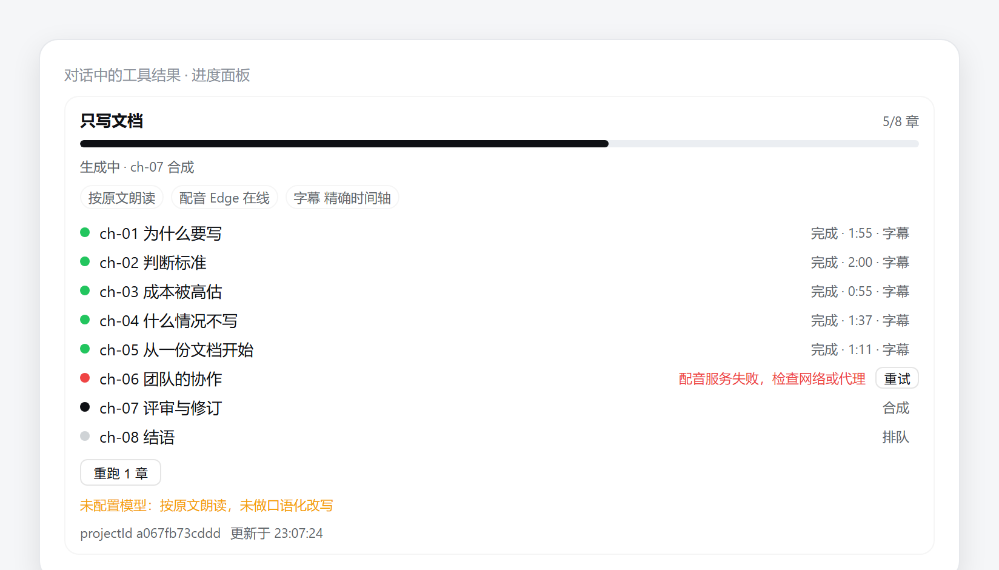
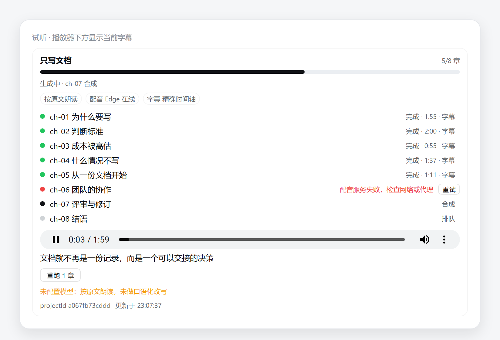

# dsh-tts

DSH 音频能力，两个包：

| 包 | 角色 | 一句话 |
|---|---|---|
| [`@leiboss/dsh-tts`](packages/tts) | 引擎层 | 文本进、音频文件出；并发、缓存、分块、降级，并暴露可注入的 `ctx.tts` 服务 |
| [`@leiboss/dsh-voiceover`](packages/voiceover) | 产品层 | 长文进、成套成果出：分章、口播化改写、字幕、manifest、可断点续跑 |

设计文档在 [`docs/`](docs)：

- [`docs/DESIGN.md`](docs/DESIGN.md) — 定位、产物契约、架构、降级矩阵、D 线 daemon/MCP、里程碑
- [`docs/PROMPTS.md`](docs/PROMPTS.md) — 生产链路提示词 P0a–P7、评测集、反模式
- [`docs/BUILD-PROMPTS.md`](docs/BUILD-PROMPTS.md) — 给 AI 编程代理的 M0–M6 实现提示词
- [`docs/INSTALL.md`](docs/INSTALL.md) — **给别人用**：安装、首次上手、配置、常见问题、发布清单

## 长什么样

对话里的进度面板（进行中：五章完成、一章失败可重试、两章待跑）：



点某章试听，播放器下方实时显示当前字幕：



> 这两张图由 `scripts/render-panel-shots.mjs` 用**真实组件代码**（`packages/voiceover/client/client.js`）
> 与 DSH 主题 token 渲染，**不是 App 内截图**。想要真机截图：在装了插件的 Web profile 里跑一篇文，
> 截面板、播放、失败重试三处，覆盖 `docs/images/` 下同名文件即可。

## 开发

需要 Node ≥ 22.18（`node --test` 直接跑 TypeScript 需要类型剥离）。

```bash
npm install          # 首次：刷新 workspace 的 lockfile
npm run build        # 先 tts，后 voiceover
npm test             # 两个包的 node --test
npm run check:engines
```

一次性跑单个测试文件（比整个 runner 快，也绕开子进程限制）：

```bash
node packages/voiceover/test/pipeline.test.ts
```

## 安装（用户侧）

```bash
dsh plugin --profile <profile> add @leiboss/dsh-tts        # 只要引擎
dsh plugin --profile <profile> add @leiboss/dsh-voiceover  # 产品或引擎一起装
```

`@leiboss/dsh-voiceover` 的 `cordis.patch.yml` 会同时挂载引擎（id `voiceover-tts`），所以只装产品包即可；两个都装也不会撞 id。

## 状态

| 能力 | 状态 |
|---|---|
| 引擎服务化（`ctx.tts`） | 已实现 + 单测 + **宿主验证**（DSH 0.2.2-rc.1） |
| 纯 JS 时长测量（MP3 帧解析） | 已实现 + 单测 |
| 分章 / 改写 / 质检 / 合成 / 字幕 / manifest | 已实现 + 单测 |
| 断点续跑（内容哈希） | 已实现 + 单测 |
| 宿主联调脚本 | [`scripts/host-probe/run.ps1`](scripts/host-probe/run.ps1) |
| 零依赖引擎（`edge-js`） | 已实现 + 单测 + 宿主验证：真实合成、精确时长、词边界随缓存保留 |
| 对话内进度面板（client） | 已实现：进度条、逐章状态、降级提示、试听、整项目/单章续跑 |
| 本地 daemon（`serve`） | 已实现：HTTP API（bearer token、Range、202 异步任务）；MCP 未实现 |
| zip / m4b 导出 | 未实现 |

## 许可

MIT
## 宿主联调

一键复现（会建一个临时 headless profile，跑完自动删除）：

```powershell
pwsh -File scripts/host-probe/run.ps1
```

验证内容与失败修复记录见 [`docs/HOST-VERIFICATION.md`](docs/HOST-VERIFICATION.md)：服务挂载、bundle patch 按 id 合并、单次挂载、真实合成（`edge-js`、精确时长）、词边界随缓存命中保留。
## 本地 daemon

```powershell
$env:DSH_VOICEOVER_TOKEN = "换成一个随机串"
node packages/voiceover/dist/serve-entry.js serve --port 7801
```

默认只绑 `127.0.0.1`，没有 token 直接拒绝启动。所有请求带 `Authorization: Bearer <token>`
（`/healthz` 除外），音频支持 Range 便于拖动。端点和示例见
[`packages/voiceover/README.md`](packages/voiceover/README.md#本地-daemon)。
