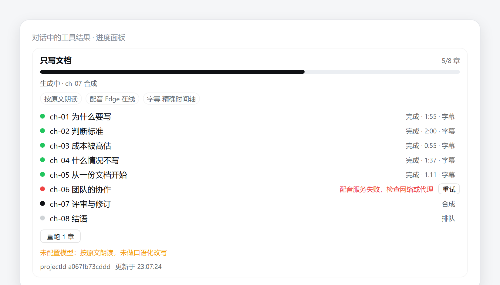
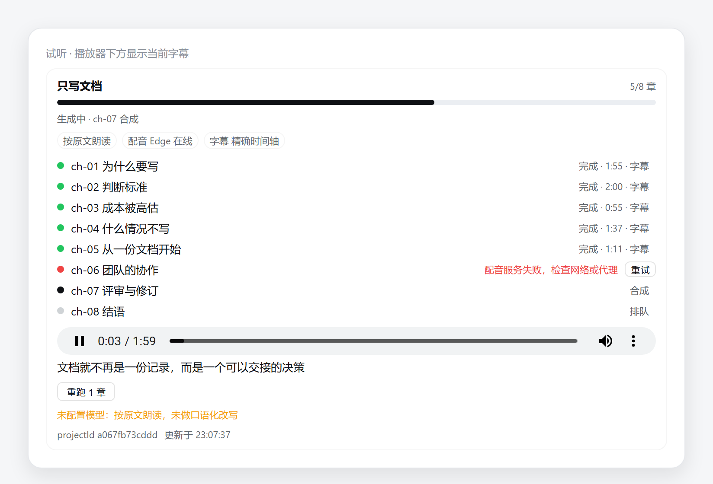

# @leiboss/dsh-voiceover

把一篇长文变成一套可发布的有声内容：分章、口播化改写、逐章合成、字幕、manifest，可中断可续跑。

不是「把一句话读出来」——那是 `@leiboss/dsh-tts` 的 `tts_generate`。

## 安装

```bash
dsh plugin --profile <profile> add @leiboss/dsh-voiceover
```

会连带挂载引擎 `@leiboss/dsh-tts`（见 `cordis.patch.yml`）。

配置（DSH 配置层）：

| 项 | 默认 | 说明 |
|---|---|---|
| `outputDir` | `$DSH_HOME/voiceover` | 项目根目录 |
| `defaultVoice` | `zh-CN-XiaoxiaoNeural` | 默认音色 |
| `defaultRate` | `+0%` | 默认语速 |
| `style` | `news` | `lecture` / `news` / `story` / `docs` |
| `auditSample` | `2` | 前 N 章必检；长章（>3000 字）也必检 |
| `llmBaseUrl` | 空 | OpenAI 兼容端点；为空则按原文朗读 |
| `llmApiKey` | 空 | 端点密钥 |
| `llmModel` | `deepseek-chat` | 记录进 manifest |

## 用法

```text
把 D:\docs\ai-engineering.md 做成有声书，女声，每章带字幕
```

1. `voiceover_create` — 立即返回 `projectId`，后台开始跑
2. `voiceover_status` — 轮询逐章进度
3. `voiceover_export` — 拿到音频、字幕、manifest 的绝对路径

## 产物

```
<outputDir>/<projectId>/
  source/normalized.md
  script/ch-01.md
  audio/ch-01.mp3
  audio/ch-01.est.srt      # estimated 时带 .est
  state/state.json          # 断点续跑依据
  manifest.json             # 契约，schema 见 schemas/
```

## 降级矩阵

| 模型 | 网络 | 行为 | 产物 |
|---|---|---|---|
| ✅ | ✅ | 完整流水线 | 口播稿 + 精确/估算字幕 |
| ✅ | ❌ | 改写照做，合成走本地引擎 | 文稿好、音色机械 |
| ❌ | ✅ | 按原文直读 | 书面语，字幕估算 |
| ❌ | ❌ | 最简模式 | 可听、无改写 |

降级都会写进 `manifest.warnings` 与 `capability`，不静默。

## 已知限制

- 只支持 `.md` / `.txt` 输入（PDF/DOCX 待做）
- 运行跟随宿主进程；宿主要求「创建即返回」，所以长任务在后台，进程退出即中断（可用 `voiceover_status` 续跑）
- 字幕质量为 `estimated` 时文件名带 `.est`，不要当帧级精确使用
- 暂无 UI 面板 / daemon / zip 导出
## 对话内进度面板

`voiceover_create` / `voiceover_status` 的结果下方会渲染一个进度面板（仅 DSH Web 宿主）：

- 标题 + `完成/总章数` + 进度条
- 能力条：`模型 改写`／`按原文朗读`、`Edge 可达`／`本地引擎`、`字幕 精确`／`估算`
- 逐章状态（排队/改写/合成/完成/失败）、时长、是否带字幕
- 降级与失败原因（warnings）
- 多语言：面板文案注册在客户端 locale 命名空间 `voiceover`（`zh` / `en` 两套字典），跟随宿主语言切换实时重渲染；
  宿主没有 locale 服务时回退中文
- 无障碍：进度条是 `role="progressbar"`（带 `aria-valuetext`），状态词是 `aria-live="polite"` 播报区，
  按钮为原生 `<button>` 且带可见焦点环，纯装饰的计数对屏幕阅读器隐藏

面板从工具结果里取 `projectId`，随后轮询宿主只读路由 `GET /voiceover/panel/<projectId>.json`
（同一会话围栏，只返回进度，不返回稿件正文与文件路径）。首章规划期间显示「准备中」，
不再误报接口不可用。



> 由 `scripts/render-panel-shots.mjs` 用真实组件代码与 DSH 主题 token 渲染，不是 App 内截图。

**试听**：面板顶部有一个播放器，每章行尾的 `▶` 切换到该章；URL 是宿主签发的同源链接
（`/voiceover/audio/...`，有效期 6 小时、与浏览器会话绑定），刷新进度不会打断播放。
无 Web 宿主时不显示播放控件，用 `voiceover_export` 拿文件路径。要续跑失败的章节，
对同一份源文再执行一次 `voiceover_create` 即可（项目 ID 由内容哈希决定，已完成的章节会跳过）。



播放时面板从 `GET /voiceover/panel/<id>/subtitles/<chapter>` 取当前章字幕，按播放进度逐句显示；
同一路由加 `.vtt` 后缀返回 WebVTT，可给浏览器的 `<video><track>` 用。
## 续跑

失败章节不必重建整个项目，可以整项目续跑，也可以只重跑一章：

- 整项目：对 agent 说「续跑这个项目」→ `voiceover_rerun`（只传 `projectId`），或点面板底部的「重跑 N 章」
- 单章：`voiceover_rerun` 传 `chapter: "ch-03"`，或点该章行尾的「重试」
- 未指定的章节保持原状（文件与状态都不动），id 写错会直接报错而不是静默什么也不做

两条路径调用的是同一个宿主实现（`src/operations.ts` 的 `rerunProject`），面板按钮只是 POST
`/voiceover/panel/<projectId>/rerun`。已完成的章节按内容哈希跳过，失败或缺失的重新跑；
`style` 会随 state 持久化，所以重算出的 projectId 与原来一致——不一致时操作会报错拒绝，
而不是悄悄写进另一个目录。

## 工具

| 工具 | 作用 |
|---|---|
| `voiceover_create` | 建项目，立即返回 `projectId` |
| `voiceover_status` | 查看逐章进度 |
| `voiceover_export` | 返回音频、字幕、manifest 的绝对路径 |
| `voiceover_rerun` | 续跑：跳过已完成章节；传 `chapter` 时只重跑该章 |
## 本地 daemon

```powershell
$env:DSH_VOICEOVER_TOKEN = "<random>"
node dist/serve-entry.js serve --port 7801 [--host 127.0.0.1] [--output <dir>]
```

只绑回环地址；无 token 拒绝启动。除 `/healthz` 外每个请求都要
`Authorization: Bearer <token>`。

| 方法 | 路径 | 作用 |
|---|---|---|
| GET | `/healthz` | 存活与版本（免 token） |
| GET | `/v1/doctor` | 引擎自检 + 端点探测 |
| POST | `/v1/tts` | 短句合成 → `{ filePath, durationMs, timingQuality, engine }` |
| POST | `/v1/voiceover` | 建项目 → `202 { projectId, statusUrl }`（`sourcePath` 或 `sourceText` 二选一） |
| GET | `/v1/projects/:id` | 与面板同源的进度快照 |
| GET | `/v1/projects/:id/manifest` | 完整 manifest |
| POST | `/v1/projects/:id/rerun` | 续跑 → `202`；body 可选 `{"chapter":"ch-03"}` |
| GET | `/v1/projects/:id/audio/:chapter.mp3` | 音频，支持 `Range`（206） |
| GET | `/v1/projects/:id/subtitles/:chapter(.est).srt` | 字幕 |

```powershell
curl -H "Authorization: Bearer $env:DSH_VOICEOVER_TOKEN" `
     -H "content-type: application/json" `
     -d '{"sourcePath":"D:\\docs\\a.md","style":"news"}' `
     http://127.0.0.1:7801/v1/voiceover
```

建项目和续跑都是异步的：立即返回 202，进度靠 `/v1/projects/:id` 轮询。
上游限流时 `/v1/tts` 返回 `429` + `Retry-After: 30`（引擎自身会先按 2s/6s/18s
退避重试同一引擎，预算耗尽才降级），调用方照 `Retry-After` 重试即可。
## 字幕怎么看（重要）

`.srt` 是旁挂文件，**Windows 自带播放器和浏览器都不会自动加载它**。三种能真正看到字幕的方式：

| 方式 | 需要什么 | 适用 |
|---|---|---|
| 面板内播放 | 无 | 在 DSH 里试听：播放器下方按时间轴显示当前这一句 |
| VLC 等支持旁挂字幕的播放器 | 把 `ch-01.srt` 与 `ch-01.mp3` 放同目录同名 | 本机任意系统 |
| 浏览器 `<track>` | 用 `.vtt`（面板路由已提供转换） | 自建网页播放器 |
| 封装成 MP4 / 烧录进画面 | ffmpeg | Windows 自带播放器、发给别人 |

### 面板内

播放某章时，进度条下方的文本会跟着朗读实时切换——字幕面板只从
`GET /voiceover/panel/<id>/subtitles/<chapter>` 取，不额外落盘。

### VLC

```
ch-01.mp3
ch-01.srt     ← 同名同目录
```

VLC 打开 mp3 会自动加载同名字幕；Windows 的「电影和电视」「Media Player」不会。

### 浏览器

`<audio>` 元素不渲染字幕，必须用 `<video>` 承载（音频轨也能放在 video 里）：

```html
<video controls src="/voiceover/audio/...">
  <track kind="subtitles" srclang="zh" label="中文" default
         src="/voiceover/panel/<id>/subtitles/ch-01.vtt">
</video>
```

### 封装或烧录（让 Windows 自带播放器也能看）

```bash
# 封装：MP4 + mov_text 字幕轨（VLC / 部分播放器可切换）
ffmpeg -i ch-01.mp3 -i ch-01.srt -map 0:a -map 1:0 -c:a copy -c:s mov_text ch-01.mp4

# 烧录：字幕画在画面里，任何播放器都能看（需要先造一路视频画面）
ffmpeg -f lavfi -i color=c=black:s=1280x720:r=1 -i ch-01.mp3 -vf "subtitles=ch-01.srt" \
       -shortest -c:a aac -c:v libx264 ch-01-burned.mp4
```

这两条命令需要 ffmpeg；插件不内置它，也不会因为缺它而失败。
